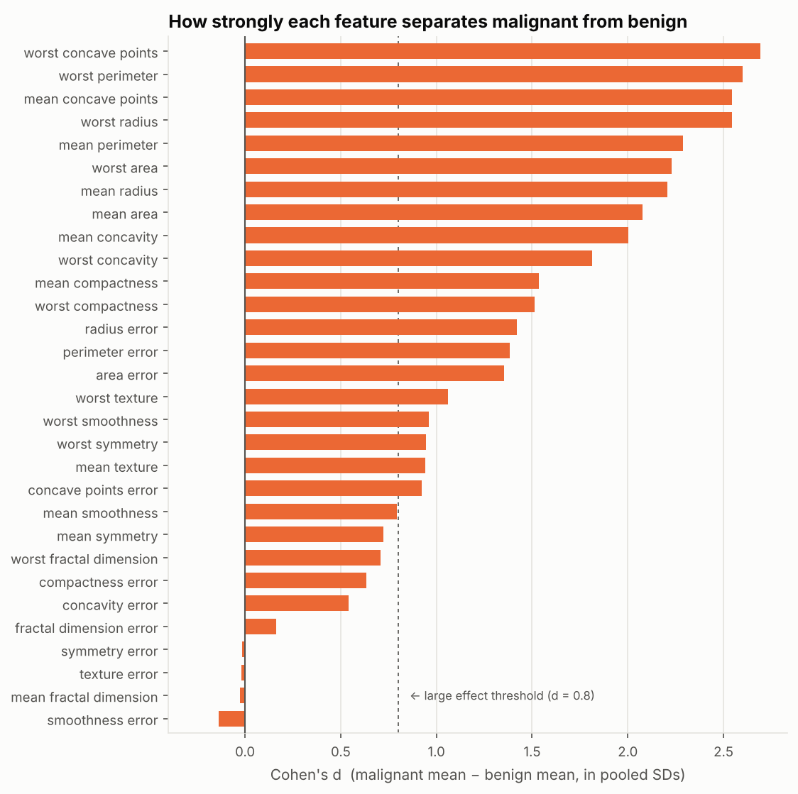
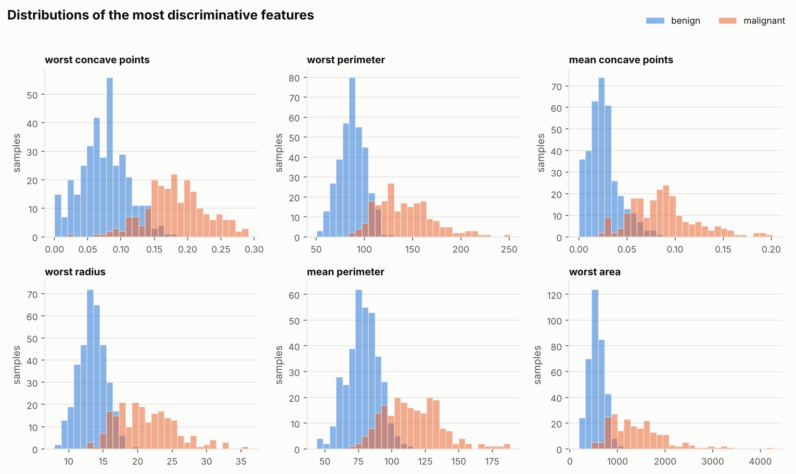
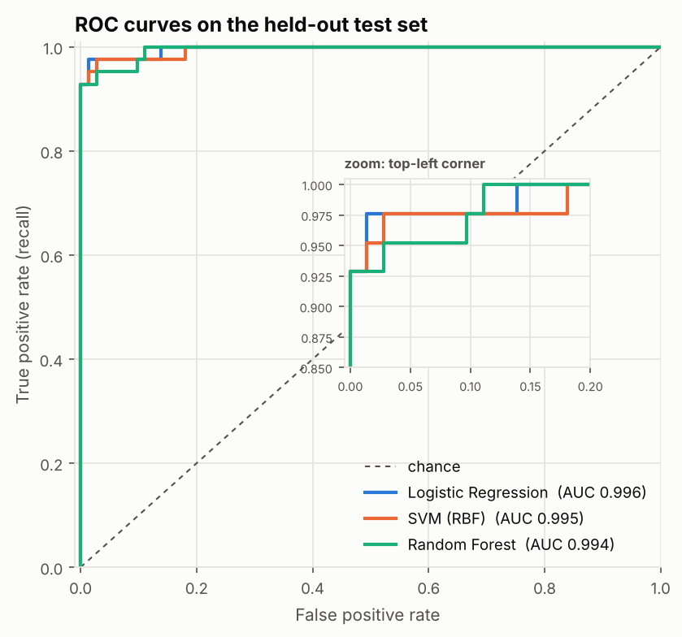
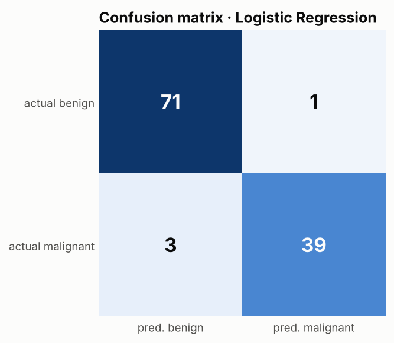

# 乳腺肿瘤诊断数据分析 · Breast Cancer Diagnostic Analysis


一个完整、可复现的数据分析项目：基于威斯康星乳腺癌诊断数据集（WDBC，569 个样本 × 30 个细胞核特征），完成**数据清洗 → 统计检验 → 可视化 → 机器学习建模 → 自动生成报告**的全流程。

一条命令即可复现全部结果，无需手动下载数据。

## 主要发现

| | |
| --- | --- |
| 显著差异的特征 | 30 个中有 **27** 个（Mann-Whitney U 检验，BH 校正） |
| 最强区分特征 | `worst concave points`、`worst perimeter`、`mean concave points`（Cohen's d > 2.5） |
| 最佳模型 | 逻辑回归，测试集 **ROC AUC 0.996**，准确率 **96.5%**，恶性召回率 **92.9%** |



恶性肿瘤的细胞核明显更大、轮廓凹陷更多：



<p>
  
  
</p>

👉 完整分析见 **[outputs/report.md](outputs/report.md)**。

## 快速开始

```bash
git clone https://github.com/Zzzxy22/breast-cancer-analysis.git
cd breast-cancer-analysis

python -m venv .venv
source .venv/bin/activate        # Windows: .venv\Scripts\activate
pip install -r requirements.txt

PYTHONPATH=src python -m bc_analysis
```

Windows PowerShell 下把最后一行换成：

```powershell
$env:PYTHONPATH="src"; python -m bc_analysis
```

也可以安装为命令行工具：`pip install -e .` 之后直接运行 `bc-analysis`。

### 命令行参数

| 参数 | 说明 | 默认值 |
| --- | --- | --- |
| `--csv PATH` | 使用自己的 CSV（需包含 30 个特征列和 `diagnosis` 列，值为 `M`/`B`，兼容 Kaggle 版本） | 内置数据集 |
| `--out DIR` | 输出目录 | `outputs/` |
| `--seed N` | 随机种子 | `42` |

### 运行测试

```bash
python -m pytest -q
```

## 项目结构

```
breast-cancer-analysis/
├── src/bc_analysis/
│   ├── data.py        # 数据加载与清洗
│   ├── stats.py       # 描述统计、Mann-Whitney U 检验、Cohen's d、相关性
│   ├── model.py       # 交叉验证比较模型、测试集评估
│   ├── plots.py       # 图表（色盲友好配色）
│   ├── report.py      # 生成 Markdown 报告
│   └── __main__.py    # 命令行入口
├── tests/             # pytest 单元测试与端到端测试
├── outputs/           # 分析产出：报告、图表、CSV 结果
└── .github/workflows/ci.yml   # GitHub Actions：自动测试并上传报告
```

## 方法

1. **清洗**：统一列名、标准化标签、去重与去缺失，兼容 Kaggle 等常见 CSV 格式。
2. **统计检验**：多数特征右偏，故使用非参数的 Mann-Whitney U 检验；用 Benjamini-Hochberg 方法控制多重比较的假发现率；用 Cohen's d 衡量效应大小。
3. **共线性分析**：识别相关系数 ≥ 0.9 的特征对（如半径、周长与面积）。
4. **建模**：8:2 分层划分训练/测试集；在训练集上用 5 折分层交叉验证比较逻辑回归、RBF 核 SVM 和随机森林；以 ROC AUC 选择最佳模型并在测试集上评估。
5. **解释**：逻辑回归的标准化系数说明模型依赖哪些特征。

## 数据来源

Wolberg, W., Mangasarian, O., Street, N., & Street, W. (1993). *Breast Cancer Wisconsin (Diagnostic)*. UCI Machine Learning Repository. 本项目通过 scikit-learn 的 `load_breast_cancer()` 加载。

## 免责声明

本项目仅用于学习和展示数据分析方法，不构成任何医疗建议。

## License

[MIT](LICENSE)
