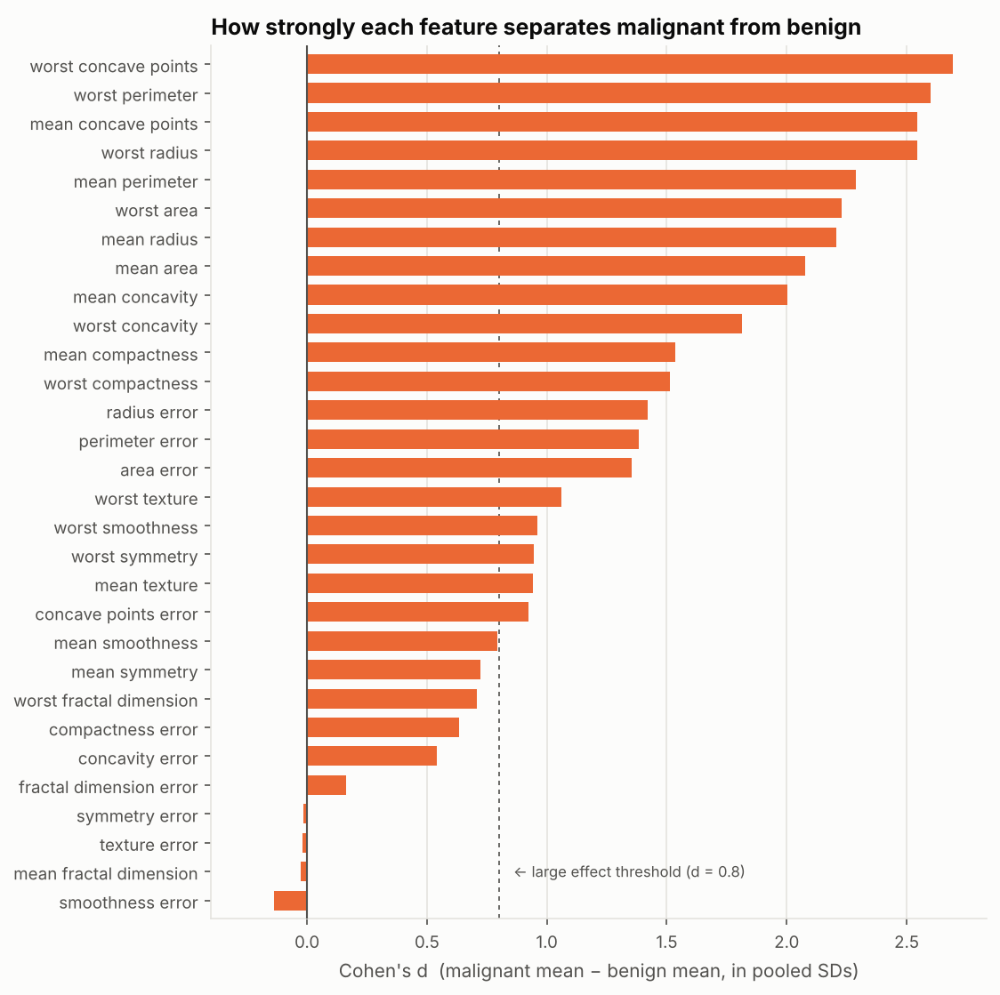
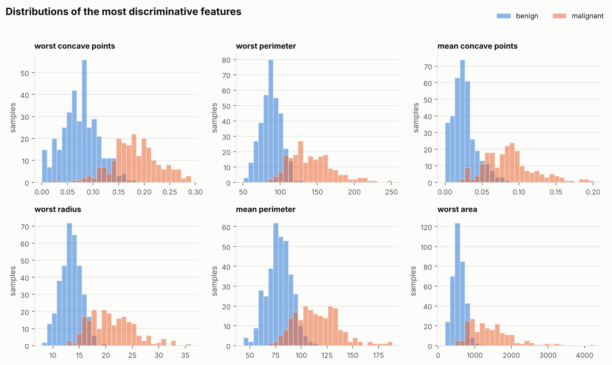
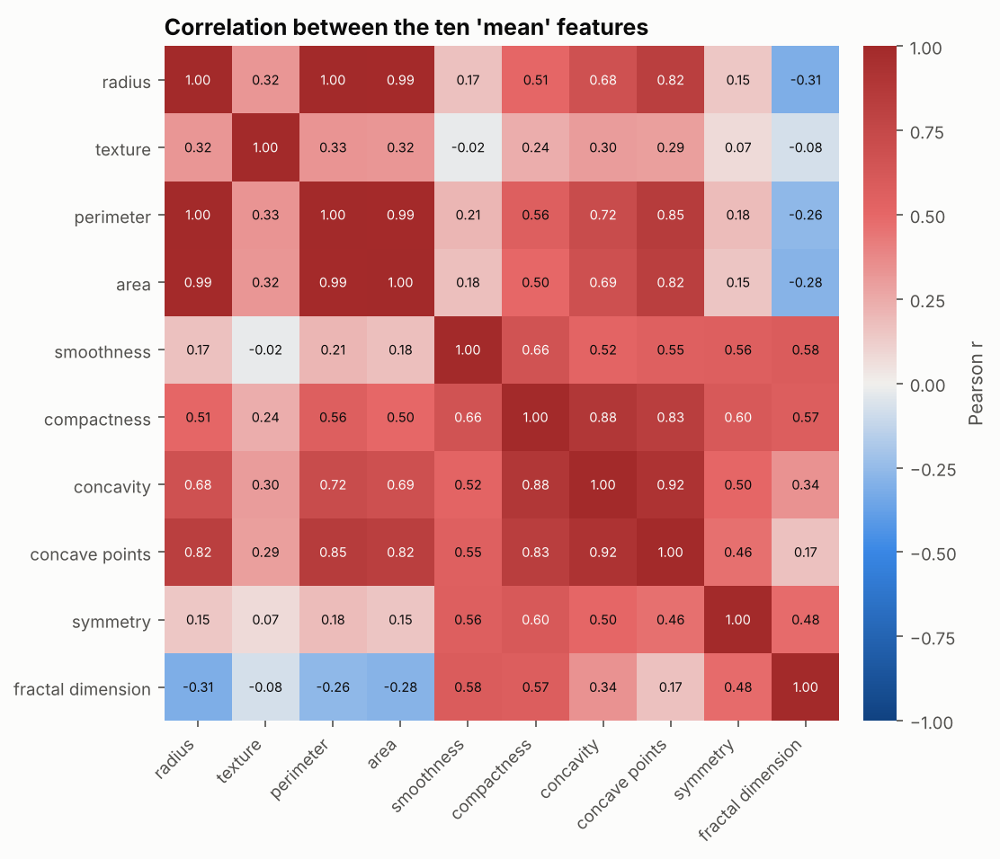
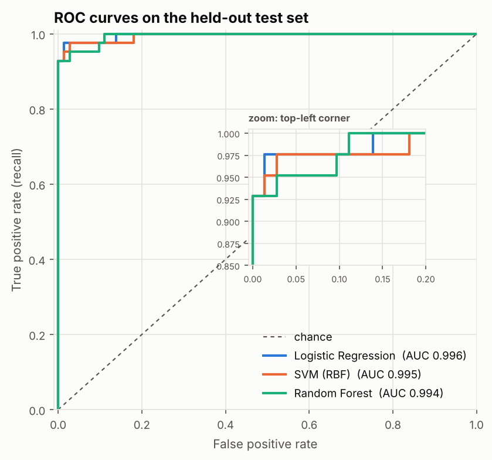
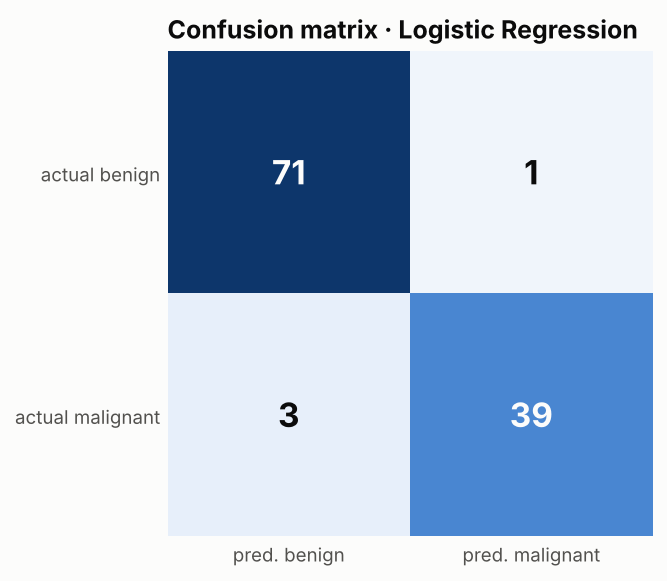
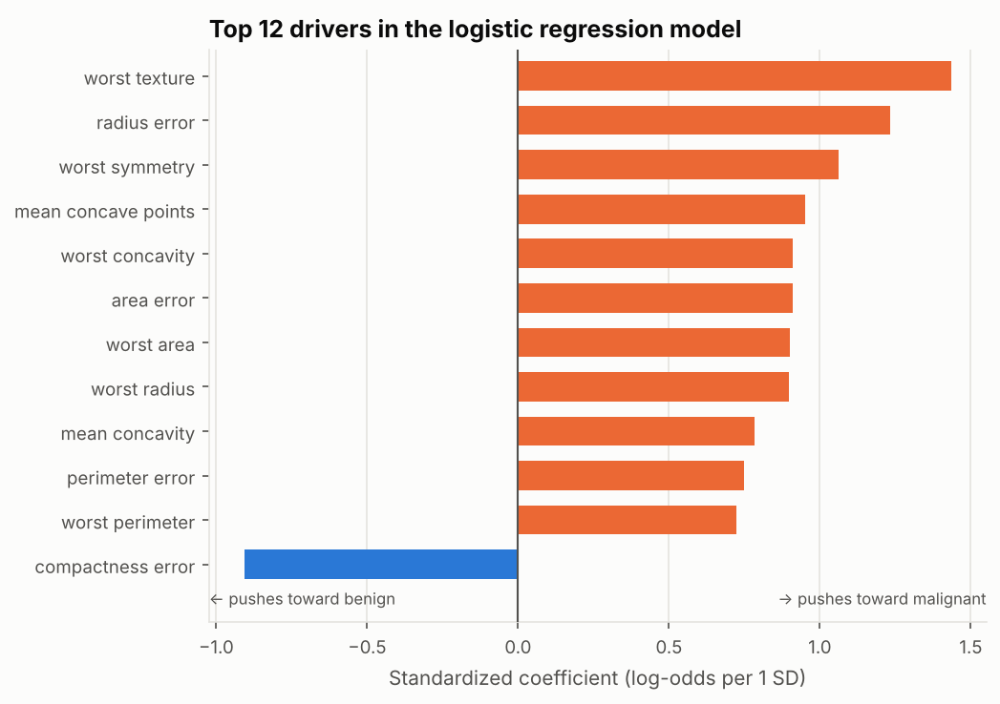

# 乳腺肿瘤诊断数据分析报告

> 自动生成于 2026-11-06 · 数据：Wisconsin Diagnostic Breast Cancer (WDBC)

## 1. 核心结论

- 数据共 **569** 个样本、30 个特征，其中恶性 **212** 例（37.3%），良性 **357** 例（62.7%），类别轻度不平衡。
- 30 个特征中有 **27** 个在两组之间存在显著差异（Mann-Whitney U 检验，Benjamini-Hochberg 校正，α = 0.05）。
- 区分能力最强的是描述**细胞核大小与轮廓凹陷程度**的特征：`worst_concave_points`（d = 2.69）、`worst_perimeter`（d = 2.60）、`mean_concave_points`（d = 2.55）。
- 交叉验证表现最好的模型是 **Logistic Regression**。在留出的 114 个测试样本上：ROC AUC **0.996**，准确率 **96.5%**，恶性召回率 **92.9%**（漏诊 3 例，误报 1 例）。

## 2. 数据概况与清洗

- 来源：scikit-learn 内置的 WDBC 数据集（UCI 机器学习库），每个样本由乳腺肿块细针穿刺的数字化图像计算得到。
- 每类细胞核测量（半径、纹理、周长、面积、光滑度、紧密度、凹度、凹点、对称性、分形维数）各有三种统计量：`mean`（均值）、`error`（标准误）、`worst`（最差三个值的均值）。
- 清洗步骤：列名统一为 snake_case；诊断标签统一为 `malignant` / `benign`；去除重复行与缺失值（本数据集均为 0）。

## 3. 哪些特征能区分恶性与良性？

对每个特征比较恶性组和良性组。由于多数特征呈右偏分布，使用非参数的 Mann-Whitney U 检验，并用 Cohen's d 衡量差异大小（|d| ≥ 0.8 通常视为大效应）。

效应量最大的 5 个特征：

| 特征 | 恶性均值 | 良性均值 | Cohen's d | 校正后 p 值 |
| --- | --- | --- | --- | --- |
| worst concave points | 0.182 | 0.074 | 2.693 | 1.4e-76 |
| worst perimeter | 141.370 | 87.006 | 2.598 | 7.7e-79 |
| mean concave points | 0.088 | 0.026 | 2.545 | 6.0e-76 |
| worst radius | 21.135 | 13.380 | 2.544 | 1.7e-77 |
| mean perimeter | 115.365 | 78.075 | 2.290 | 1.8e-70 |

差异最小的特征是 `mean_fractal_dimension`、`texture_error`、`symmetry_error`，它们几乎不携带诊断信息。

恶性样本的细胞核明显更大、轮廓凹陷更多，两组分布在这些特征上几乎可以被一条阈值分开。

## 4. 特征之间的相关性

共有 **21** 对特征的相关系数绝对值 ≥ 0.9，例如 `mean_radius` 与 `mean_perimeter`（r = 1.00）、`worst_radius` 与 `worst_perimeter`（r = 0.99）、`mean_radius` 与 `mean_area`（r = 0.99）。半径、周长和面积本质上描述的是同一件事（细胞核大小），因此建模时使用了带正则化的模型，解读单个系数时也需要谨慎。

## 5. 预测模型

把数据按 8 : 2 分层划分为训练集和测试集，在训练集上用 5 折分层交叉验证比较三种模型（均值 ± 标准差）：

| 模型 | ROC AUC | 准确率 | 召回率 | F1 |
| --- | --- | --- | --- | --- |
| Logistic Regression | 0.996 ± 0.005 | 0.974 ± 0.015 | 0.953 ± 0.040 | 0.964 ± 0.021 |
| SVM (RBF) | 0.995 ± 0.005 | 0.976 ± 0.008 | 0.959 ± 0.040 | 0.967 ± 0.012 |
| Random Forest | 0.988 ± 0.007 | 0.960 ± 0.016 | 0.935 ± 0.039 | 0.946 ± 0.023 |

最佳模型 **Logistic Regression** 在测试集上的混淆矩阵：

| 指标 | 数值 |
| --- | --- |
| ROC AUC | 0.996 |
| 准确率 | 96.5% |
| 召回率（恶性被识别出的比例） | 92.9% |
| 精确率（判为恶性中真正恶性的比例） | 97.5% |
| F1 | 0.951 |

在医疗筛查场景中，**漏诊（假阴性）的代价远高于误报**，因此召回率比准确率更值得关注；实际应用中可以通过降低判定阈值来进一步提高召回率。

## 6. 模型在看什么？

逻辑回归的标准化系数表示：特征每增加一个标准差，恶性的对数几率变化多少。

推动预测偏向恶性的主要特征是 `worst_texture`、`radius_error`、`worst_symmetry`；`compactness_error`、`fractal_dimension_error` 的系数为负。由于特征间存在强共线性，单个系数的正负不宜孤立解读，应结合第 3 节的单变量分析一起看。

## 7. 局限性

- 样本量较小（569 例）且来自单一机构，模型的泛化能力需要在外部数据上验证。
- 本项目用于学习数据分析方法，**不构成任何医疗建议**。
